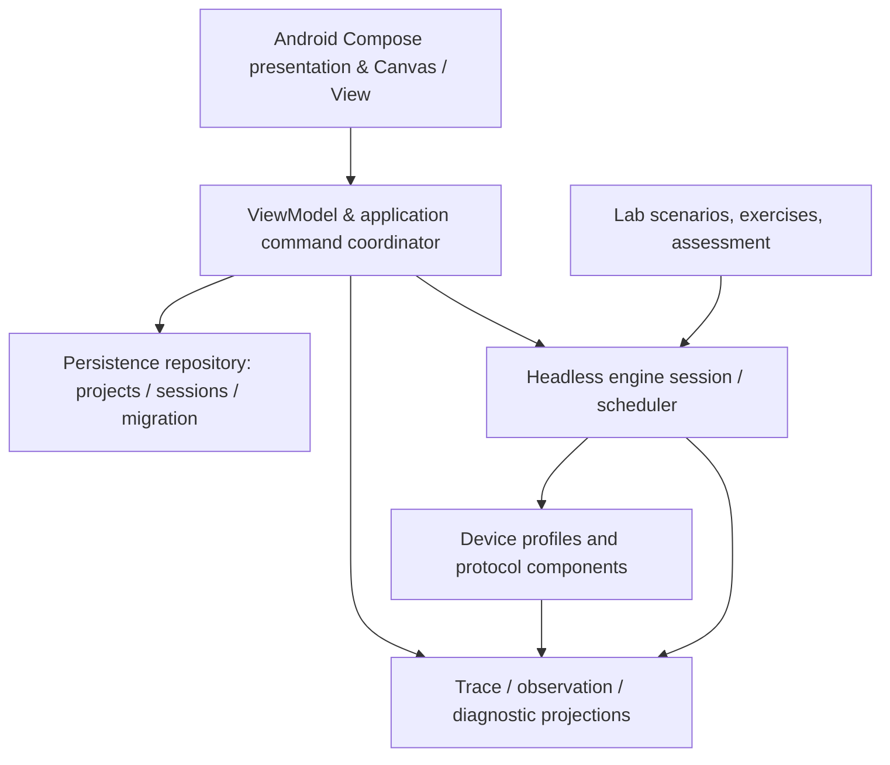

# Architecture blueprint — VirtualNetLab
Status: PROPOSED v0.2 | 2026-10-23. Behavioral contracts are requirements; technology details are testable recommendations. See [review](ARCHITECTURE_REVIEW.md).

## A. Functional workflow
**Edit/construct → configure → validate → execute (step/run) → observe path and state → diagnose → modify → replay/compare → save/share/assess.** Real-time and simulation mode are *presentation/execution controls of one engine*, not two implementations of the network.

## B. Modules, responsibilities and dependency direction

Strict dependency: engine modules NEVER import Android, Compose, ViewModel, Room, lifecycle, or canvas objects. Trace projections are read-only; device engines do not depend on renderers. No hidden network calls in offline execution.

Candidate Gradle modules (not frozen yet): `model`, `sim-core`, `protocols-ethernet`, `protocols-ipv4`, `protocols-dhcp`, `devices`, `diagnostics`, `scenario-testkit`, `lab-format`, `android-app`. Avoid premature modules without actual boundary pressure.

## C. Three states: never conflate
1. **Design/configuration state** (versioned durable): topology, device profile, port capabilities/roles, VLANs, addressing, routing table configuration, services and policies, simulation seed. This is what user saves and edits.
2. **Execution/runtime state** (snapshot/checkpoint): clock, events, MAC/ARP/route cache, DHCP FSMs & leases, protocol timers, outstanding packets and counters. Derived from configuration + actions, optionally resumable.
3. **Presentation state** (Android-only): zoom/pan, selection, dialog, visible trace filter, color preference, animation playback. Must not change packet outcomes.
Composition invariant: `same design + same starting runtime + same ordered actions + same engine/model version + same seed = same semantic trace` (including event ordering). Version mismatches must be visible and handled as explicit migrations.

## D. Identity and topology graph
Stable typed IDs for node, physical port, logical interface, link, broadcast domain, packet and event; never use human-readable name or screen coordinates as key. Device profile describes **capabilities**, not a fixed router/switch class: number and type of ports, LAN/WAN roles, L2 bridge groups, L3 interfaces, media type, optional services, defaults and version. Router WAN and LAN ports have different broadcast domains even if equally physical Ethernet.

A physical link has exactly two distinct valid compatible endpoints, neither already occupied on point-to-point port; validity must be checked independently of intended design. Auto-connect ranks candidates and shows selected endpoints with warnings, never claims network-design correctness. L2 switch forwarding tables indexed by bridge domain, VLAN and MAC; not just global MAC. Interface state and protocol enablement are independent of physical link presence.

## E. Event kernel, messages and command queue
- Engine session is single-writer. Android posts intent `ConfigurePort`, `ConnectPorts`, `StartDhcp`, `InjectProbe`, `RunUntil`, `Pause`; commands are validated into transactions or rejected with typed errors; command ACK includes updated revision.
- Immutable scheduled event envelope: `eventId, virtualTimeTicks, insertionSeq, targetActor, eventKind, payloadRef, parentEventId?, correlationId?, modelVersion`. Queue order is (virtualTimeTicks, insertionSeq). Time is bounded integral ticks; no floating-time sorting, wall-clock dependence, mutable timestamps or negative delays.
- Processing is atomic at event granularity: read actor/session state, apply deterministic transition, schedule events, publish resulting state delta + trace. Define behavior for configuration edits while paused or running: queue command at safe boundary; topology mutation that invalidates scheduled work cancels/revalidates affected events.
- Define zero-delay scheduling policy and maximum same-tick work; record `SIMULATION_EVENT_BUDGET_EXCEEDED` rather than hang. Bound per-run events, depth, outstanding packets, time range and trace retention. Deterministic seeded PRNG is sole randomness provider.
- `Step` processes one **scheduled internal event**; `Step protocol/PDU` is a view helper over related internal events, never different physics. Playback speed maps visual timing to event timestamps but doesn't alter simulation behavior. Background control traffic remains in queue even if filtered from UI.

## F. Packets and protocols: hybrid strategy, not premature byte-stream dogma
Baseline protocol messages are typed immutable PDUs with real header fields and validation, supporting optional concrete encode/decode for tested wire formats. Packets cannot be mere UI labels. A frame has structured source/destination MAC, EtherType, optional VLAN tag, payload identity; clone/forward must preserve semantic provenance while allowing legitimate mutable fields (TTL, checksum). Define serialization/PCAP capability level separately; NEVER label partial synthetic packets as wire-compatible captures.

Layers: link/media scheduler -> Ethernet bridge/VLAN -> optional IP host/router stack -> transport (UDP/TCP where implemented) -> application service (DHCP/DNS) + management. Control-plane BPDUs/DTP/DHCP are actual messages with state machines, not visualization triggers. Protocol handlers produce typed output actions and new events, never draw.

For packet-buffer speed/memory, measure alternatives: (A) typed object trees, (B) immutable logical payload + byte-backed header slices, (C) direct ByteArray decode/encode. Keep schema abstraction flexible until spike results. No costly deep clones or full packet copies by default.

## G. Device behaviors
Composable device = profile + physical ports + bridge(s) + optional IP stack(s) + services + protocol capabilities + timers; one device may contain multiple internal bridge/routing domains (home wireless router). Do not imply all router models run DTP or STP. Host IPv4 route resolution must decide: local/self-delivery, on-link ARP, configured gateway, no route; a wire event only occurs when actually transmitted. MAC learning must be keyed by logical bridge domain and age out per timer. Router forward decrements TTL, handles MTU/fragmentation policy and routing based on specified modeled subset; unsupported behavior declared.

DHCP: separation of client FSM, IPv4LL FSM, server pools bound to ingress interface/broadcast domain and optional relay, and gateway option. IPv4LL does not imply DHCP stopped; link-local address does not provide an off-link route. Define conflict probes, retries, lease renew/expire later per RFC 3927/2131. Never simulate an ACK if no server actor sent it.

## H. Truthful observations and probes
Trace append-only (during a run) with typed records: event identity/correlation, stimulus, packet identity, source/destination, ingress/egress port, *state transitions*, forwarding/decision outcome, reason code and model capability version. Distinguish **network events** (simulation) from **diagnostic projections** (UI). Reason codes may be `NO_ROUTE_NO_GATEWAY`, `DHCP_POOL_NOT_BOUND_TO_INGRESS`, `PORT_BLOCKED_BY_STP`, `LINK_DOWN`, but only when actual transition conditions match. All "why" explanations cite the event IDs and inputs, not AI guesswork.

`Probe` has `originDeviceId, originInterfaceId, destinationAddress` and optionally `expectedTargetDeviceId/interfaceId, expectedPathConstraints`; its results have separate booleans `echoReplyObserved`, `expectedTargetConfirmed`, `expectedPathConfirmed`, plus timing/path evidence. Local-self-ping doesn't prove a cable or remote router worked. Transparent unresolved identity.

## I. Diagnostics and educational activities
Lab scenario = versioned topology+constraints+initial actions+assessment assertions on protocol/runtime/trace, not screenshots. Test "correctness" should not require a single unique IP scheme when alternatives are valid. Guided hints can explain actual trace, distinguish suggestions from definitive faults, and avoid silently fixing errors.

## J. Persistence & versioning
- Saved **portable lab design** separate from optional **run session checkpoint** and potentially large **event trace**. Version project schema, individual device profile/capability versions, engine version, protocol version and scenario schema.
- Kotlin Serialization JSON is plausible for human-readable exported topology, but use strict decode & validation, explicit migration and bounded input; an archive wrapper or binary trace will be evaluated. Treat JSON parsing as *syntax*, not topology validation.
- Use atomic write (write temp, fsync where appropriate, replace) with failure recovery and frequent autosave of design; Android's Room may index recent labs while export/import uses Storage Access Framework. A partially saved run is never presented as a complete trace.
- Refuse/limit malicious inputs: size, nesting, event counts, path traversal, duplicate IDs, unknown dangerous capability, decompression limits, version not supported and cyclic impossible links. No execution of scripts from imported scenarios without sandboxed DSL.
- Support deterministic replay from design + ordered commands + seed; snapshot serialization and resuming an active run are separate later gates.

## K. Android execution / UX
- Compose app shell for screens; topology graph renderer may be Compose Canvas/custom View depending on spike results. World-space viewport with hit-tested ports/cables; pan/zoom/lasso and explicit port selector; touch targets accessible, hardware keyboard/pen/mouse where possible.
- ViewModel exposes filtered, throttled immutable summaries rather than every event object as per-frame recomposition. Detail inspectors fetch trace segments lazily and preserve correlation filters.
- Engine runs off main/UI thread with a single serialized command processor; lifecycle-aware observation, explicit pause/snapshot when backgrounded. Background indefinite execution is NOT baseline and must not be conflated with time in simulation.
- Separate physical/logical topology, device editor/CLI, packet timeline/OSI inspection, scenario goals; accessible equivalents for graph controls and color-independent states.
- Capability/status legend makes unsupported functions visible. No broad storage/network permissions for core offline app; avoid required cloud account.

## L. Nonfunctional / governance boundaries
- Latency, frame-rate, event-rate, memory, power, APK size, minimum SDK are **hypotheses until measured** on 4 GB-class Android device. Test 10/50/100-node scenarios and 1k/10k/100k event runs; budgets will be set using collected baseline distribution.
- Third-party dependency BOM and SPDX/license analysis before importing source or binaries; Cisco Packet Tracer and vendor IOS are behavioral references only, not source-code donors.
- Changes to engine protocol or schema require ADR, protocol support update, golden traces, negative tests and evidence. Every new module must be routed by ICM and have explicit Graphify dependencies. Detailed gates: [roadmap](IMPLEMENTATION_ROADMAP.md), [validation](VALIDATION_STRATEGY.md), [risks](RISK_REGISTER.md).
